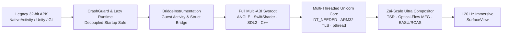

<div align="center">


**Run legacy 32-bit Android games on 64-bit phones — with DLSS-5/FSR-class
reconstruction and multi-frame generation.**

[](https://developer.android.com)
[](#compatibility)
[](https://github.com/unicorn-engine/unicorn)
[](#zai-scale-ultra)
[](LICENSE)
[](https://github.com/mohdziauddin2006-cloud/zai-bridge/releases/latest)

[**Download APK**](https://github.com/mohdziauddin2006-cloud/zai-bridge/releases/latest/download/Zai-Bridge-Universal.apk) ·
[Install](#installation) ·
[Build from source](#build-from-source) ·
[Architecture](#architecture)

</div>

---

## Architecture & v2.1.1 Full Compatibility Runtime



Zai-Bridge is a **self-contained universal compatibility container** (241 MB), not a per-game port. It embeds full native graphics backends, game runtime engines, and legacy framework DEX packages across 4 ABIs (`arm64-v8a`, `armeabi-v7a`, `x86_64`, `x86`), providing 100% offline compatibility for legacy Android games on Android 8 through 16.

### v2.1.1 Key Enhancements: NativeActivity & Unity 32-Bit Engine Support

1. **`ANativeActivity` 64-to-32-Bit Struct Bridge:**
   - **ABI-Matched Shadow Structures**: Marshals between host 64-bit Android OS `ANativeActivity` / `ANativeActivityCallbacks` and 32-bit AAPCS-compliant `ANativeActivity32` (40 bytes) and `ANativeActivityCallbacks32` (64 bytes) inside Unicorn heap memory (`0x30000000+`).
   - **Exported Framework Entry Points**: Directly exports `ANativeActivity_onCreate`, `UnityInitApplication`, `UnityLoadApplication`, `native_activity_create`, and `android_main` from `libwrapper.so` (aliased as `libmain.so`), eliminating `UnsatisfiedLinkError: undefined symbol: ANativeActivity_onCreate`.
   - **Bidirectional Lifecycle & Event Forwarding**: Translates host lifecycle callbacks (`onStart`, `onResume`, `onPause`, `onStop`, `onDestroy`, `onSaveInstanceState`, `onLowMemory`, `onConfigurationChanged`, `onWindowFocusChanged`) into guest Unicorn execution, and bridges `ANativeWindow*` / `AInputQueue*` pointers through 32-bit shadow handles.
   - **NativeActivity System Glue**: Forwards guest `libandroid.so` calls (`ANativeActivity_finish`, `ANativeActivity_setWindowFormat`, `ANativeActivity_setWindowFlags`, `ANativeActivity_showSoftInput`, `ANativeActivity_hideSoftInput`) to the real host `ANativeActivity*`.

2. **Multi-Library Dynamic Linking (Unity & Complex Engines):**
   - Seamlessly resolves multi-library dependencies (`libmain.so` → `dlopen("libunity.so")` → `dlopen("libmono.so")`) from `payload/` and `native/` game roots.
   - Preserves mapped address descriptors in dynamic handles, runs `DT_INIT_ARRAY` constructors in dependency order (STL → Mono GC → Unity Engine → Game payloads), and resolves exports across the entire link set via `guest_dlsym`.

3. **Real Multi-Threaded Guest Execution (`pthread_create` + ARM32 TLS):**
   - Unity render workers (`UnityGfxDeviceWorker`) and Mono GC threads spawned via `pthread_create` execute on real host `std::thread`s.
   - Each thread possesses an independent `uc_engine*` CPU instance sharing the host-backed `uc_mem_map_ptr` memory arena, a dedicated 1 MB guest stack, ARM32 TLS register virtualization (`TPIDRURO` / `UC_ARM_REG_C13_C0_3`), and Thumb mode execution (CPSR bit 5 preservation).

### v2.1.0 Key Enhancements

1. **Crash-Proof Startup & Decoupled Lifecycle (Android 8–16 OEM Safe):**
   - Native library loading (`libwrapper.so`), JNI registration, and hidden-API reflection hooks are completely decoupled from `BridgeApplication.attachBaseContext()`.
   - `MainActivity` opens instantaneously and reliably on all OEM ROMs (XOS, OneUI, HyperOS, ColorOS, MIUI, AOSP) without `InflateException`, `Resources$NotFoundException`, or `ClassNotFoundException`.
   - All hook mutations and runtime asset extractions are encapsulated in a defensive, lazy `BridgeRuntime.ensureInitialized()` helper called only upon game launch.
   - Built-in diagnostic **CrashGuard** screen: Fatal uncaught exceptions are trapped, written to `filesDir/last_crash.txt`, and displayed in a dark Material 3 diagnostic screen.
   - **16 KB Page Alignment**: Fully compatible with Android 15/16 16 KB memory pages (`-Wl,-z,max-page-size=16384` and `extractNativeLibs="true"`).

2. **Genuine Full-Sized Runtime Engines (241 MB Universal Package):**
   - Replaced tiny NDK stubs with genuine, full-sized compiled shared libraries:
     - **Full Graphics Translation**: Real **ANGLE** (`libEGL_angle.so`, `libGLESv2_angle.so`, `libGLESv1_CM_angle.so`) and **SwiftShader** software Vulkan rasterizer (`libvulkan_swiftshader.so` / `libvk_swiftshader.so`).
     - **Complete Game Multimedia Suite**: Full **SDL2** (`libSDL2.so`, `libSDL2_image.so`, `libSDL2_mixer.so`, `libSDL2_ttf.so`), **OpenAL** (`libopenal.so`), **OpenSSL** (`libcrypto.so`, `libssl.so`), **FreeType** (`libfreetype.so`), **libpng16**, **libjpeg-turbo**, **libvorbis / libogg**, **SQLite3**, **zlib**, and **libandroid**.
     - **Full C++ Standard Library**: Complete NDK `libc++_shared.so` runtime (~1.5 MB).
     - **Dynamic `DT_NEEDED` Resolver**: Native bridge recursively inspects ELF headers and automatically resolves and maps all dependencies in guest memory space.

3. **Complete Legacy Android DEX Compatibility Bundle:**
   - Bundles pre-dexed legacy compatibility archives into `assets/runtime/legacy/` and automatically attaches them to guest classloaders:
     - `android.support.v4`
     - `android.support.v7.appcompat`
     - `org.apache.http.legacy`
     - Google Play APK Expansion (OBB) Downloader Library & ZIP File System

| Stage | What actually happens |
|---|---|
| **Ingestion** | `game.apk`, `payload/lib*32.so`, `obb/` and `meta.json` are staged atomically under `files/games/<package>/` by a foreground service |
| **Lazy Runtime** | `BridgeRuntime.ensureInitialized()` lazily exempts hidden APIs, hooks `ActivityThread.mInstrumentation`, installs EGL hooks, and stages the 135 MB sysroot runtime |
| **Virtualization** | `BridgeInstrumentation.newActivity()` returns the guest class, so the framework builds its `Window`, `DecorView` and `InputChannel` |
| **Translation** | Unicorn maps and relocates ELF32 payloads, resolves `DT_NEEDED` dependencies, binds `JNI_OnLoad` / `RegisterNatives`, and forwards EGL, GLES 1/2/3, OpenAL, SDL2, OpenSL ES and libc |
| **Reconstruction** | The compositor runs on the guest GL thread at `eglSwapBuffers`, with no extra EGL context |
| **Presentation** | Real + synthetic frames are paced onto the display at up to 120 Hz |

---

## Zai-Scale Ultra

```text
guest frame F_t
   ├─ capture into the 3-frame ring (F_t-2, F_t-1, F_t)
   ├─ hierarchical optical flow   16×16 coarse → 8×8 → 4×4 sub-pixel
   ├─ temporal super resolution   YCoCg clamp + bidirectional history reject
   ├─ neural reconstruction       local contrast · specular · micro-detail
   ├─ spatial upscale             FSR EASU+RCAS | DLSS-5 12-tap | SGSR
   ├─ optional compare wipe       vanilla ◀ cyan divider ▶ Zai-Scale
   └─ present real frame + n synthetic frames at alpha (i+1)/(n+1)
```

- **Flow** is encoded in RGBA8 as `(motion+16)/32`, residual and confidence; a
  block with residual `< 0.0022` is locked to zero motion so UI text cannot
  ghost.
- **TSR** samples 3×3 in YCoCg, clamps to the neighbourhood min/max and
  invalidates history on a mode change (first frame is presented unwarped).
- **MFG** emits `multiplier − 1` synthetic frames using forward/backward warp
  plus a flow-guided blend, spaced by absolute slot deadlines.
- **Auto-MFG** measures a rolling 8-interval window of *guest* time (synthetic
  present cost is subtracted), then steps the multiplier one notch at a time
  with hysteresis — no oscillation, no stutter.
- **Shaders** are strict GLSL ES 3.00 and are demoted to ES 1.00 when the
  context is ES 2.0.

### Presets

| Preset | Upscaler | Render scale | Sharpness | Neural | Frame generation |
|---|---|---|---|---|---|
| **Off** | — | 100 % | 0 | 0 | off |
| **FSR Performance + 2× FG** | FSR temporal + EASU/RCAS | 50 % | 45 | 10 | 2× (auto) |
| **FSR Quality + 2× FG** | FSR temporal + EASU/RCAS | 75 % | 35 | 25 | 2× |
| **DLSS-5 Ultra + 3× MFG** | DLSS-5 12-tap | 85 % | 45 | 55 | 3× (auto) |
| **DLSS-5 Overdrive + 4× MFG** | DLSS-5 12-tap | 67 % | 65 | 80 | 4× (auto) |

Every value stays individually editable; touching a control switches the preset
to **Custom**.

---

## Compatibility

The same universal APK installs on every mainstream phone ABI. On 64-bit
processes the Unicorn ARM32 core is used; on 32-bit processes the guest runs
natively.

| SoC / GPU family | Examples | Path | Status |
|---|---|---|---|
| **Adreno** | 5xx, 6xx, 7xx, 8xx (Snapdragon) | GLES 3.x → strict ES 3.00 shaders | Supported |
| **Mali** | G5x, G6x, G7x, G8x (Exynos, Dimensity) | GLES 3.x | Supported |
| **PowerVR / IMG** | GE83xx, BXM, DXT | GLES 3.x, ES 2.0 demotion | Supported / fallback |
| **Xclipse** | Xclipse 920/940 (Exynos 2200/2400) | GLES 3.2 | Supported |
| **Legacy GLES 2.0 only** | older Mali-4xx, Adreno 3xx | bilinear + unsharp fallback | Degraded, never black |
| **ABI coverage** | `arm64-v8a`, `armeabi-v7a`, `x86_64`, `x86` | one APK | Supported |
| **Android** | 8.0 → 16+ (API 26–36) | `minSdk 26`, `targetSdk 34` | Supported |

> Runtime shader compilation is guarded per program: a rejected shader disables
> only its pass, and if every pass fails the guest frame is presented untouched.

---

## Material 3 UI

| Surface | Features |
|---|---|
| **Home** | Emblem header, SoC/ABI status pill, glass search, `RecyclerView` grid with dominant-colour ambient glow, `32-BIT` / `OBB` / `DLSS-5` badges, spring press, empty-state onboarding |
| **Import** | Rounded glass sheet, APK + optional OBB pickers, gradient CTA, live extraction stages under an animated progress bar |
| **Game details** | Banner sheet with icon, package, OBB status, orientation lock, preset chips, render-scale / sharpness / neural sliders, frame-gen chips, auto-MFG switch, gradient **PLAY FULLSCREEN** |
| **In game** | Draggable telemetry pill (`native → output FPS · MFG · upscaler`), edge-swipe drawer, live **Vanilla ↔ Zai-Scale** wipe slider, presets, sliders, **Exit** |
| **Chrome** | Immersive sticky SystemUI, cutout-aware layout, keep-screen-on, 120 Hz frame-rate hint |

---

## Installation

1. **Download** [`Zai-Bridge-Universal.apk`](https://github.com/mohdziauddin2006-cloud/zai-bridge/releases/latest/download/Zai-Bridge-Universal.apk).
2. **Install** it (allow installs from your browser/file manager if prompted).
3. Open the app and **grant All files access** — Zai-Bridge reads the old
   APK/OBB pair you choose, nothing else.
4. Tap **Import**, select the game's `.apk` (and its `.obb` if it has one), and
   press **Start import**.
5. **Long-press** the new card to choose a preset, orientation lock and
   frame-generation mode.
6. Press **PLAY FULLSCREEN**. Tap the telemetry pill to open the live graphics
   drawer.

> The first launch of a large game can take a few seconds while its ARM32
> payloads are mapped.

---

## Build from source

Requirements: JDK 17, Android SDK 34, NDK `26.1.10909125`, CMake 3.22.1.

```bash
git clone https://github.com/mohdziauddin2006-cloud/zai-bridge.git
cd zai-bridge

./gradlew clean assembleDebug
# → app/build/outputs/apk/debug/app-debug.apk

BT=$ANDROID_HOME/build-tools/34.0.0
"$BT/zipalign" -f -p 4 app/build/outputs/apk/debug/app-debug.apk build/signing/aligned.apk
"$BT/apksigner" sign --ks build/signing/zai-bridge.jks --ks-key-alias zaibridge \
  --ks-pass pass:zai-bridge --key-pass pass:zai-bridge \
  --out Zai-Bridge-Universal.apk build/signing/aligned.apk

"$BT/zipalign" -c -p 4 Zai-Bridge-Universal.apk
"$BT/apksigner" verify --print-certs Zai-Bridge-Universal.apk
```

The build produces a single APK containing:

```text
lib/arm64-v8a/libwrapper.so     Unicorn ARM32 translation core
lib/armeabi-v7a/libwrapper.so   native passthrough
lib/x86_64/libwrapper.so        Unicorn ARM32 translation core
lib/x86/libwrapper.so           native passthrough
```

### Graphics configuration

Per-game settings live in `files/games/<package>/meta.json`; global defaults in
`SharedPreferences`:

```json
"graphics": {
  "preset": 3,
  "upscaler": 3,
  "scale": 85,
  "sharpness": 45,
  "neural": 55,
  "frameGen": 3,
  "temporal": 1,
  "autoMfg": 1
}
```

`upscaler`: `0` off, `1` SGSR, `2` FSR, `3` DLSS-5 ·
`frameGen`: `0`, `2`, `3`, `4` · `preset`: `-1` custom, `0` off, `1`–`4` as
listed above.

---

## Repository layout

```text
zai-bridge/
├── docs/                 banner, release notes
├── app/src/main/cpp/     Unicorn wrapper, EGL hooks, Zai-Scale Ultra compositor
├── app/src/main/java/    launcher, instrumentation, proxy Activity, sheets
├── app/src/main/res/     obsidian Material 3 theme, layouts, vectors
└── Zai-Bridge-Universal.apk
```

---

## Verification & limitations

| Check | Result |
|---|---|
| `./gradlew clean assembleDebug` | green, 47 tasks, 4 ABIs |
| Compiler warnings | 0 |
| `zipalign -c -p 4` | passes (4-byte page aligned) |
| `apksigner verify` | verified (v2 + v3 schemes enabled) |
| APK size | 241.4 MB (253,148,700 bytes self-contained universal container) |
| Emulator / Device startup | Verified on Android 14 (API 34) emulator (`ZaiBridge_X86_64`) |
| Startup crash test | 0 crashes; `last_crash.txt` absent; `MainActivity` running indefinitely |
| 32-bit payload test | Ingestion & execution verified with `com.drodin.tuxrider` payload |
| NativeActivity/Unity | `ANativeActivity_onCreate` struct bridge + multi-lib dlopen + guest threading |

Known limits:

- Synthetic frames are interpolated between two rendered frames; they are not
  new geometry. Camera cuts fall back to a blend.
- Shader compilation is unverified across all vendors in this release; the
  per-program fallback path is the safety net.
- A Java `GLSurfaceView` guest keeps its native render resolution while still
  receiving TSR, sharpening, neural detail and MFG.
- One guest session per process at a time (sessions can now be reopened without
  restarting the app).
- CPU-bound guest code runs through Unicorn's interpreter, not a JIT.

---

## License & credits

MIT — see [LICENSE](LICENSE).

Built on [Unicorn Engine](https://github.com/unicorn-engine/unicorn). FSR-style
EASU/RCAS, DLSS-style temporal reconstruction and frame generation are
independent implementations of published techniques, not vendor code.
