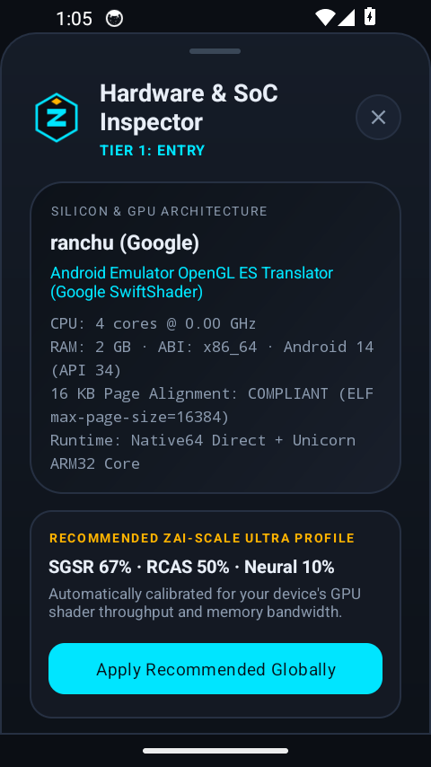
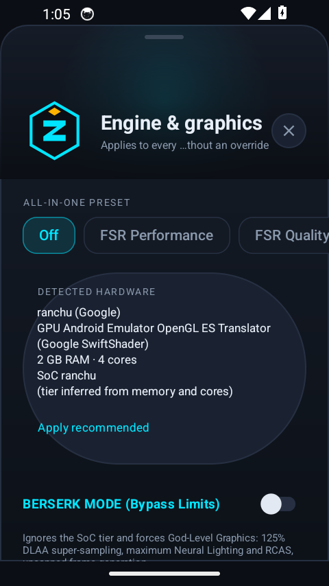
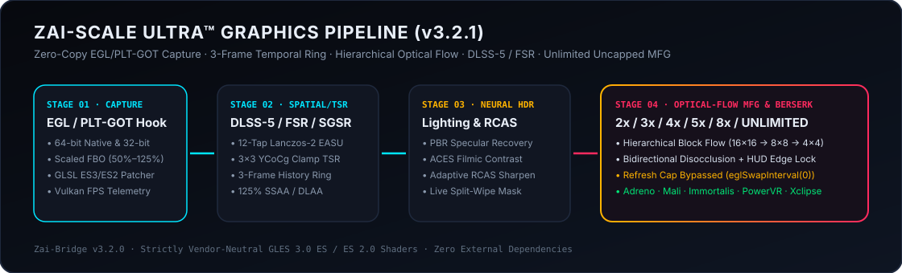
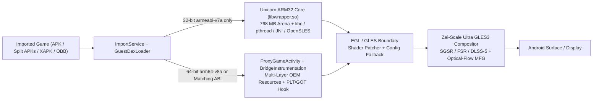

<div align="center">
  

  <p>
    <a href="https://github.com/mohdziauddin2006-cloud/zai-bridge/releases/latest">
      
    </a>
    
    
    <a href="LICENSE">
      
    </a>
  </p>

  <p>
    <strong><a href="https://github.com/mohdziauddin2006-cloud/zai-bridge/releases/latest">Download the latest universal APK (Zai-Bridge-v3.2.1-Universal.apk)</a></strong>
  </p>
</div>

Zai-Bridge is an Android application container built to keep older **32-bit (`armeabi-v7a`)** Unity and native NDK games running on 64-bit-only phones, while also hosting **64-bit (`arm64-v8a`)** and split-APK games inside a unified OpenGL ES 3.0 post-processing shell.

No root, no custom kernel, and no patched ROM is required. One universal APK ships all four ABIs (`arm64-v8a`, `armeabi-v7a`, `x86_64`, `x86`) with 16 KB ELF alignment for Android 15 and 16.

---

## What It Does

- **Runs 32-bit ARM (`armeabi-v7a`) games on 64-bit phones**: Loads guest ARMv7 ELF libraries into an isolated 768 MB arena backed by the Unicorn CPU engine, resolves dynamic imports, and bridges `libc`, `pthread`, `zlib`, `OpenSL ES`, `JNI`, and `EGL`/`GLESv2`/`GLESv3` calls onto the host 64-bit process.
- **Hosts 64-bit and Split-APK games across Android 8 to 16+**: Virtualizes guest `Activity`, `Application`, `ClassLoader`, `PackageManager`, and `Resources`/`AssetManager` bindings across stock AOSP and OEM skins (One UI, HyperOS/MIUI, ColorOS/OxygenOS/Realme UI, Funtouch/OriginOS, XOS/HiOS) so base and split APKs load their own resources without crashing on OEM `Resources` subclasses.
- **Applies Zai-Scale Ultra GLES3 compositing**: Intercepts frames at the EGL boundary (Java surface path for 32-bit guests and PLT/GOT hooks for native 64-bit titles) for SGSR, FSR (EASU + RCAS), or DLSS-5 neural/temporal scaling, 2x–8x / Unlimited optical-flow frame generation, and live split-screen wipe comparison.
- **Inspects live SoC and GPU hardware accurately**: Queries the live EGL `GL_RENDERER` first rather than blindly trusting static tables, reads per-core `cpuinfo_max_freq` in kHz to separate shared silicon IDs (such as MediaTek `MT6855` across Dimensity 7020 / 7025 / PowerVR BXM-8-256), and snaps physical RAM cleanly to standard hardware tiers (`2–24 GB`).

---

## Screenshots

| Launcher Library | Live Hardware Inspector |
| :---: | :---: |
|  |  |
| **Zai-Scale Ultra Controls** | **32-bit Guest Rendering Live** |
|  |  |

---

## How It Works

<div align="center">
  
</div>

Depending on what an imported APK contains, Zai-Bridge routes execution down one of two native paths while sharing the same graphics boundary:



On `arm64-v8a` and `x86_64` hosts, `libwrapper.so` links statically against Unicorn Engine to translate `armeabi-v7a` machine code. On native `armeabi-v7a` and `x86` hosts, `wrapper_passthrough.cpp` runs without CPU emulation. `libbridge_alias_shim.so` forwards guest `System.loadLibrary` lookups cleanly into the single loaded runtime instance without duplicating native state.

---

## Zai-Scale Ultra Modes

All settings can be applied globally or per game (stored inside each title's `meta.json`):

| Mode / Preset | Upscaler | Render Scale | Sharpness | Neural Detail | Frame Gen | Notes |
| --- | --- | --- | --- | --- | --- | --- |
| **Off** | Off | 100% | 0% | 0% | Off | Native rendering with passthrough swap |
| **SGSR Battery** | SGSR | 75% | 35% | 10% | Off | Single-pass 12-tap edge-aware scaling |
| **FSR Performance** | FSR | 50% | 45% | 10% | 2x (Auto) | Temporal FSR + adaptive multi-frame gen |
| **FSR Quality** | FSR | 75% | 35% | 25% | 2x | Balanced EASU + RCAS + temporal clamp |
| **DLSS-5 Ultra** | DLSS-5 | 85% | 45% | 55% | 3x (Auto) | Temporal TSR ring + specular detail pass |
| **DLSS-5 Overdrive** | DLSS-5 | 67% | 65% | 80% | 4x (Auto) | High-multiplier optical-flow interpolation |
| **Berserk Mode** | DLSS-5 | 125% (DLAA) | 100% | 100% | UNLIMITED | Super-samples above panel, bypasses SoC caps |

Custom tuning exposes manual Upscaler selection (`Off`, `SGSR`, `FSR`, `DLSS-5`), Scale (`50%` / `67%` / `75%` / `85%` / `100%` / `125%`), Sharpness (`0–100%`), Neural (`0–100%`), Frame Gen (`Off`, `2x`, `3x`, `4x`, `5x`, `8x`, `UNLIMITED`), Auto MFG, and an interactive **Split Compare** slider.

---

## Universal SoC Tiers

`SoCProfiler` inspects `Build.SOC_MODEL`, `ro.hardware`, `ro.board.platform`, live `/sys/devices/system/cpu/*/cpufreq/cpuinfo_max_freq`, and the live EGL `GL_RENDERER` string before selecting a safe default profile from `soc_database.json`:

| Tier | Representative GPUs & SoCs | Default Upscaler | Scale | Frame Gen |
| --- | --- | --- | --- | --- |
| **Tier 1: Entry** | PowerVR GE8320/GE8300, Mali-G52/450, Adreno 308–405 | SGSR | 67% | Off |
| **Tier 2: Mainstream** | Mali-G57/G68/G72, PowerVR BXM-8-256 (Dimensity 7020/7025), Adreno 509–612 | SGSR | 75% | 2x Auto |
| **Tier 3: Performance** | Adreno 618–643, Mali-G76/G77, Xclipse 530/540, Dimensity 8100–8300 | FSR | 75% | 2x Auto |
| **Tier 4: Flagship** | Adreno 650–730, Mali-G78/G710/G715, Xclipse 920, Tensor G1–G4 | DLSS-5 | 85% | 3x Auto |
| **Tier 5: Ultra-Flagship** | Adreno 740–840, Immortalis-G715/G720/G925, Xclipse 940–960, Tensor G5 | DLSS-5 | 100% | 4x Auto |

You can override any auto-selected tier manually with per-game presets or **Berserk Mode**.

---

## Quick Start

1. Download **`Zai-Bridge-v3.2.1-Universal.apk`** from [**Releases**](https://github.com/mohdziauddin2006-cloud/zai-bridge/releases/latest).
2. Install it on any Android 8.0–16+ device (`arm64-v8a`, `armeabi-v7a`, `x86_64`, or `x86`).
3. Tap **Import** to add an APK / APKS / XAPK from storage, or pick an already installed game to virtualize inside Zai-Bridge (including split APKs).
4. Long-press any game card (or open **Hardware Inspector**) to inspect your detected SoC/GPU and configure Zai-Scale Ultra presets.
5. Tap the game card to launch.

---

## Build From Source

### Requirements
- JDK 17
- Android SDK Platform 36 (`compileSdk 36`), Build-Tools `35.0.0+`
- Android NDK `26.1.10909125` and CMake `3.22.1`

Prebuilt static `libunicorn.a` archives for `arm64-v8a` and `x86_64` live under `app/src/main/cpp/prebuilt/`.

### Commands

```bash
# 1. Clean debug build (all 4 ABIs)
./gradlew clean assembleDebug

# 2. Align & sign for distribution / in-place upgrades
zipalign -p -f 4 app/build/outputs/apk/debug/app-debug.apk app-aligned.apk
apksigner sign --ks ~/.android/debug.keystore --ks-pass pass:android --key-pass pass:android \
  --v1-signing-enabled true --v2-signing-enabled true --v3-signing-enabled true \
  --out Zai-Bridge-v3.2.1-Universal.apk app-aligned.apk

# 3. Run instrumented verification tests on a connected device/emulator
./gradlew connectedDebugAndroidTest
```

---

## Compatibility & Known Limits

- **Translation CPU overhead**: Emulating `armeabi-v7a` instructions through Unicorn on a 64-bit CPU carries real CPU cost compared to native `arm64-v8a` code; heavier late-era ARMv7 Unity games perform best on mid-range to flagship cores and may show hitching during first-run Mono/JIT warmup.
- **Anti-cheat, DRM, and Play Integrity**: Online games that enforce signature pinning, Play Integrity hardware attestation, kernel/emulator detection, or obfuscated runtime self-checks will reject containerized execution.
- **Vulkan-first titles**: Zai-Bridge hooks Vulkan presentation (`vkQueuePresentKHR`) for telemetry and passthrough stability, while Zai-Scale Ultra spatial/temporal shaders operate on OpenGL ES framebuffers.
- **Engine diversity**: Unity (`4.x` Mono through `2018–Unity 6` IL2CPP), Unreal, Cocos, and custom NDK titles cover the tested surface; games relying on undocumented OEM framework services or custom Binder daemons outside standard Android SDK APIs can still fail.
