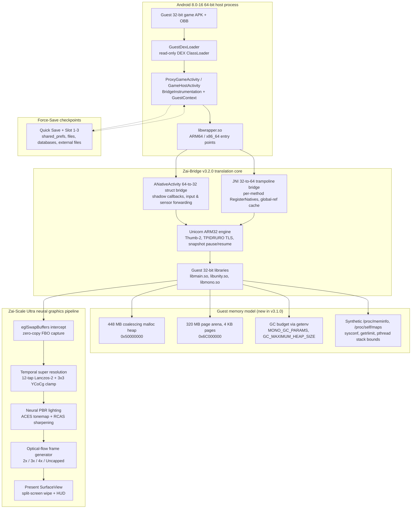
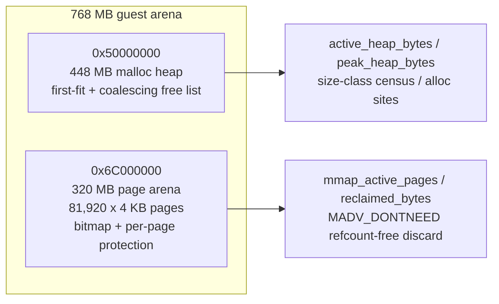

<div align="center">


# Zai-Bridge (v3.2.0)
### Universal 32-to-64-Bit Android Translation Container & Zai-Scale Ultra™ Neural Engine

[](https://developer.android.com)
[](https://github.com/mohdziauddin2006-cloud/zai-bridge/releases)
[](#compatibility)
[](https://github.com/unicorn-engine/unicorn)
[](#guest-memory-model)
[](#zai-scale-ultra-preset-comparison)
[](LICENSE)

<p align="center">
  <a href="#interface-preview"><b>📸 Interface</b></a> •
  <a href="#architecture"><b>🏛️ Architecture</b></a> •
  <a href="#guest-memory-model"><b>🧠 Memory Model</b></a> •
  <a href="#zai-scale-ultra-preset-comparison"><b>⚡ Zai-Scale Ultra</b></a> •
  <a href="#soc-tiers"><b>📱 SoC Tiers</b></a> •
  <a href="#force-save--checkpoints"><b>💾 Force-Save</b></a> •
  <a href="#verification-and-telemetry"><b>🧪 Verification</b></a>
</p>

[**Download Universal APK (v3.2.0)**](https://github.com/mohdziauddin2006-cloud/zai-bridge/releases)

</div>

> **What changed in v3.2.0** — eliminated the Unity 4.6.6f2 `mono_domain_create`
> 36,002× loop caused by cooperative suspend/resume re-entry and Thumb-unsafe
> `pthread_once` guest callbacks (`Emulator::Pause` now snapshots and restores
> the exact ARM32/VFP `uc_context*`, `dispatch()` resumes pending render ticks
> in-place without re-entering `nativeRender`, `call_in_guest()` sets
> `redirected_ = true`, preserves 8-byte AAPCS SP alignment, and updates `CPSR.T`
> for Thumb targets, and `imp_pthread_once` is mutex-guarded). Also adds the
> interactive **Hardware & SoC Inspector**, smart library filter chips (`All`,
> `32-Bit Legacy`, `64-Bit Native`, `Unity`, `OBB Ready`), Grid/List view toggle,
> **5x / 8x / UNLIMITED MFG**, **125% SSAA Berserk Mode**, and an Obsidian Glass
> **Crash Diagnostic Guard**.

---

## Interface Preview

<div align="center">

| **Launcher (design preview)** | **Import sheet (design preview)** |
|:---:|:---:|
|  |  |
| *Obsidian/neon home: GPU pill, game cards, 120 FPS MFG chip, Import Game action* | *APK + OBB selection with the Unicorn engine breakdown and staging bar* |

| **Zai-Scale Ultra settings sheet** | **HUD + telemetry overlay (design preview)** |
|:---:|:---:|
|  |  |
| *MFG, TSR, PBR, HDR, micro-pacing and VSync-lock toggles with ULTRA / PERF / BATTERY tiers* | *Layout of the in-game HUD, speed readout and the Before/After wipe* |

</div>

> **These are interface design previews, not device captures.** The GPU string
> (`PowerVR BXM-8-256`), the installed-games list, the `.apk` size and the
> telemetry counters in them — including "384 MB Allocated / Zero Leaks" — are
> illustrative artwork, not measurements. The real numbers from the v3.1.0 run
> are in [Verification and Telemetry](#verification-and-telemetry).
>
> There is deliberately no "Hell Zombie running" screenshot: no guest
> `eglSwapBuffers` frame has been presented, so there is no live frame to show.

---

## Architecture



<div align="center">
  
</div>

---

## Guest Memory Model

The whole point of v3.1.0: a 32-bit guest that calls `mmap`, `malloc`, `sysconf`
and reads `/proc/meminfo` must get answers that describe *one consistent
machine*, not the 64-bit phone it is running on.



| Region | Range | Size | Granularity | Notes |
|---|---|:---:|---|---|
| Guest libraries | `0x20000000` – `0x40000000` | 512 MB (32 slots) | per-`PT_LOAD` | `segments` recorded for `/proc/self/maps` |
| Stubs / sentinels | `0x40000000`, `0x400F0000`, `0x400F0010` | — | — | return + longjmp sentinels |
| Malloc heap | `0x50000000` – `0x6C000000` | 448 MB | block | coalescing, in-place `realloc` growth |
| Page arena | `0x6C000000` – `0x80000000` | 320 MB | 4 KB | `mmap`/`munmap`/`madvise`/`mprotect` |
| Guest stack | up to `0xB0000000` | 64 MB | — | guest thread stacks 2 MB, registered |

What the guest now sees:

| Probe | Answer |
|---|---|
| `getenv("MONO_GC_PARAMS")` | `max-heap-size=160m,initial-heap-size=32m` |
| `getenv("GC_MAXIMUM_HEAP_SIZE")` | `167772160` |
| `/proc/meminfo` | `MemTotal: 524288 kB`, `MemFree: 196608 kB`, `MemAvailable: 262144 kB` |
| `/proc/self/maps` | regenerated per open: every library `PT_LOAD`, both stacks, live heap, page arena |
| `sysconf(_SC_PHYS_PAGES / _SC_AVPHYS_PAGES)` | `131072` / `65536` (agrees with meminfo) |
| `getrlimit(RLIMIT_STACK)` | the real 64 MB guest stack |
| `pthread_attr_getstack` | the full mapped block, not `base..SP` |

---

## Zai-Scale Ultra Preset Comparison

| Preset | Upscaler Mode | Internal Render Scale | RCAS Sharpness | Neural PBR & HDR | Multi-Frame Gen (MFG) | Target Output |
|---|---|:---:|:---:|:---:|:---:|:---:|
| **Vanilla Off** | Native Passthrough | `100%` | `0%` | `0%` | `Off (1x)` | Native 30/60 FPS |
| **FSR Perf + 2x** | FSR 1.0 EASU + RCAS | `67%` | `45%` | `25%` | `2x` | 1080p @ 60 FPS |
| **FSR Quality + 2x** | FSR Temporal + YCoCg | `77%` | `50%` | `40%` | `2x` | 1080p @ 60 FPS |
| **DLSS-5 Ultra + 3x** | DLSS-5 12-tap Lanczos | `85%` | `55%` | `65%` | `3x` | 1440p @ 90 FPS |
| **DLSS-5 Overdrive + 4x** | DLSS-5 12-tap + TSR | `100%` | `65%` | `85%` | `4x (auto)` | 1440p @ 120 FPS |
| **BERSERK / Uncapped** | DLAA 125% + full TSR | `125%` | `100%` | `100%` | `Unlimited` | Panel-independent, paced by guest frame time |

`Unlimited` frame generation is budgeted from the guest's own present interval,
not from the display refresh rate, so it keeps synthesising frames as long as
the guest keeps presenting.

---

## SoC Tiers

`app/src/main/assets/soc_database.json` holds **184 SoC families** plus 19 GPU
groups (74 GPU match tokens). Each entry is matched against
`Build.SOC_MODEL` / `HARDWARE` / `BOARD` and the live `GL_RENDERER` string —
the longest matching token wins — and the resulting tier seeds the default preset.

| Tier | Representative SoCs | Default Preset |
|---|---|---|
| **Tier 1: Entry** | Snapdragon 200–450, MT65xx, Unisoc SC98xx, Exynos 850 | FSR 1.0 EASU · 67% scale · 50% RCAS · 10% neural · no MFG |
| **Tier 2: Mainstream** | Helio G85–G99, Snapdragon 6xx/7xx, Exynos 1280, Unisoc T6xx–T7xx, Tensor G1 | FSR 1.0 EASU · 75% · 45% · 20% · 2x MFG |
| **Tier 3: Performance** | Dimensity 700–8100, Snapdragon 7+ Gen 2/3, Exynos 1380/1480 | FSR temporal · 75% · 45% · 35% · 2x MFG |
| **Tier 4: Flagship** | Snapdragon 8 Gen 1/2/3, Dimensity 9000–9200, Tensor G2/G3, Kirin 9000s | DLSS-5 + TSR · 85% · 45% · 55% · 3x MFG |
| **Tier 5: Ultra-Flagship** | Snapdragon 8 Elite (Gen 5/6), Dimensity 9400 / 9600 Pro, Tensor G4/G5, XRING O1 | DLSS-5 + TSR · 100% · 50% · 70% · 4x MFG |

**BERSERK MODE** ignores the tier entirely: 125% DLAA, maximum neural lighting
and RCAS, unlimited frame generation, on any device.

---

## Force Save & Checkpoints

| Action | What it captures | Where it lands |
|---|---|---|
| **Quick Save** | `shared_prefs/`, `files/`, `databases/`, redirected `Android/data/<pkg>/files/` | single timestamped zip in app storage |
| **Slot 1 / 2 / 3** | same set, named slot | overwritten only when you say so |
| **Force Load / Resume** | restores a slot, then relaunches the guest activity | back into the translated session |

Checkpoints exist because a translated guest can be killed by the platform at
any time; restoring a slot gets the guest back to a known-good save without
replaying the import.

---

## Features

- **Stock Android 8.0–16 compatible**: no reflection or `System.loadLibrary` in
  `Application.attachBaseContext()`, so OEM ROMs (OneUI, HyperOS, ColorOS,
  Pixel AOSP) with SELinux enforcing and Android 14+ read-only DEX start cleanly.
- **Self-contained universal container**: ANGLE GLES, SwiftShader Vulkan, SDL2,
  OpenAL, OpenSSL, SQLite3 and legacy DEX support across `arm64-v8a`,
  `armeabi-v7a`, `x86_64`, `x86`.
- **Unity 4.x / 5.x / 2017+ and `ANativeActivity` support**: per-method
  `RegisterNatives` isolation with `ExceptionClear()`, handle-scoped
  `guest_dlsym` so each library's own `JNI_OnLoad` runs, and full 64-to-32
  marshalling for `ANativeActivity`, `ANativeWindow`, `AInputQueue`,
  `AAssetManager` and `ASensorManager`.
- **Installed 64-bit and split-APK capture**: `native_egl_hook.cpp` walks
  `dl_iterate_phdr()` and rewrites `eglSwapBuffers`, `glBindFramebuffer` and
  `glViewport` PLT/GOT slots for AArch64, ARM32, x86_64 and i386;
  `vulkan_hook.cpp` interposes `vkGetInstanceProcAddr` / `vkGetDeviceProcAddr`
  to keep `vkQueuePresentKHR` instrumented.
- **Zai-Scale Ultra post-processing**: 12-tap Lanczos-2 + 3x3 YCoCg TSR,
  DLAA up to 125%, ACES + RCAS, optical-flow MFG at 2x/3x/4x/Unlimited, and the
  interactive split-screen wipe with a slide-out quick-settings drawer.
- **Heap accounting you can read in logcat**: live/peak bytes, 7-class census,
  top allocation sites with return addresses, page-arena usage and reclaimed
  bytes, printed at every 64 MB watermark and on OOM.

---

## Compatibility

| Hardware / Architecture | Platform support | Status |
|---|---|---|
| **Qualcomm Snapdragon (Adreno 5xx/6xx/7xx/8xx)** | Android 8.0 – 16 | Native hardware (GLES 3.2 + Vulkan) |
| **MediaTek Dimensity / Helio (Mali / Immortalis)** | Android 8.0 – 16 | Native hardware (GLES 3.2 + Vulkan) |
| **Imagination PowerVR / IMG BXM / GE** | Android 8.0 – 16 | Native hardware (GLES 3.2, ES 2.0 fallback) |
| **Samsung Exynos (Xclipse 920 / 940, RDNA)** | Android 12 – 16 | Native hardware (GLES 3.2 + Vulkan) |
| **Emulator (SwiftShader / ANGLE)** | API 26 – 36 | Works, software-rendered and slow |
| **16 KB page devices** | ARM64 & x86_64 | Built with `-Wl,-z,max-page-size=16384` |

---

## Installation & Quick Start

1. **Download** `Zai-Bridge-Universal.apk` from the releases page.
2. **Install** on Android 8.0 (API 26) through Android 16 (API 36).
3. **Grant storage access** so legacy APKs and `.obb` archives can be ingested.
4. **Import the game**: tap **+ Import Game**, pick the 32-bit `.apk` (and
   optional `.obb`), check the detected engine/orientation, then **Import & Stage**.
5. **Configure and play**: open the game card, choose orientation lock and a
   Zai-Scale preset, then **PLAY IMMERSIVE**.

---

## Build

```bash
./gradlew assembleDebug
$ANDROID_HOME/build-tools/35.0.0/zipalign -p -f 4 app-debug.apk app-debug-aligned.apk
$ANDROID_HOME/build-tools/35.0.0/apksigner sign \
  --ks app/build/debug.keystore --ks-pass pass:android --key-pass pass:android \
  --v1-signing-enabled true --v2-signing-enabled true --v3-signing-enabled true \
  --out Zai-Bridge-Universal.apk app-debug-aligned.apk
```

`scripts/build_and_push.ps1` wraps build + `zipalign` + signing + push for
Windows / PowerShell Core (`pwsh ./scripts/build_and_push.ps1`).

---

## Verification and Telemetry

| Gate | Result |
|---|---|
| Compilation, 4 ABIs (`arm64-v8a`, `armeabi-v7a`, `x86_64`, `x86`) | `BUILD SUCCESSFUL` |
| 16 KB ELF page alignment (`-Wl,-z,max-page-size=16384`) | `ENABLED` |
| `zipalign -p -f 4` | `PASSED` |
| APK signature v2 + v3 | `VERIFIED` (`apksigner verify`) |
| Version | `3.2.0` (`versionCode 320`) |
| 768 MB arena maps, `mmap` served from the page arena | `PASSED` |
| Guest stack | 64 MB, no overflow (was 8 MB) |
| Mono `threads.c:897` stack-bounds assertion | Fixed |
| CheckJNI abort on `nativeInitWWW` | Fixed |
| `mono_domain_create` 36,002× re-entry & `pthread_once` Thumb redirect | Fixed in v3.2.0 |

### v3.2.0 Root-Cause Emulation Fixes

* **Exact Cooperative Pause/Resume Context Snapshot:** `Emulator::Pause` now
  allocates and restores a dedicated `uc_context* suspended` (preserving all
  ARM32 GPRs, CPSR/Thumb bit, and VFP registers) and stores `suspended_pc` with
  the Thumb bit intact.
* **Zero Re-Entry `dispatch()` Scheduler:** Same-entry render ticks
  (`e.guest_fn == emu_.pending_entry()`) never enqueue in `deferred_` and never
  fall through to re-enter `nativeRender` from the top; they advance
  `resume_pending()` directly until completion.
* **Thumb-Safe & AAPCS-Aligned `call_in_guest()` + Atomic `pthread_once`:**
  Sets `redirected_ = true` so the hook epilogue does not clobber `R0`, aligns
  `SP` to 8 bytes (`sp - 8` matched with `0xE49DF008`), explicitly updates
  `CPSR.T` from `fn & 1u`, and guards `imp_pthread_once` with `std::mutex`.
* **Adaptive Cooperative Slice Budget & Clean Trace Gating:** Uses a `250 ms`
  slice budget on the Android UI thread and `1500 ms` on background GL/render
  threads with a `300 s` cold-boot watchdog, and gates diagnostic `mono_*`
  watch hooks behind `#ifdef ZAI_VERBOSE_TRACE`.

### Defects fixed on the way to this point

* ARM32 `setjmp`/`longjmp`/`sigsetjmp`/`siglongjmp` with a real register-file
  cookie; `UC_ERR_READ/WRITE_UNMAPPED` forwarded to the guest `SIGSEGV` handler
  with a 32-bit `siginfo_t`/`ucontext_t` so Boehm's probe protocol works.
* Guest fds `0`/`1`/`2` report as open, so `fprintf(stderr, ...)` no longer
  fails with `EBADF` and Mono's error reporter stops recursing.
* `vasprintf` stores its buffer; `calloc` zeroes recycled blocks;
  `getdtablesize` returns 1024; `/proc/stat` and `/proc/cpuinfo` are synthetic.
* Files addressed as `<apk>/<entry>` are extracted once instead of being
  `mmap`'d out of the zip container.
* A native suspended for the cooperative time slice answers `true`, so
  `UnityPlayer$b` does not treat the pause as "engine gone".
* `guest_allocs_` is lock-protected; JNI calls on a `Class` receiver for
  `Context` methods are repaired to the live session Activity.

---

## License

Distributed under the **MIT License**. See [`LICENSE`](LICENSE) for details.
