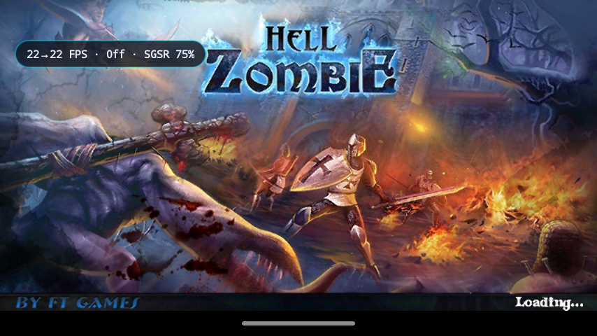
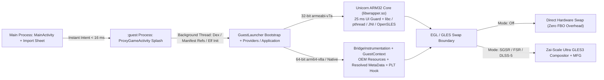

<div align="center">
  

  <p>
    <a href="https://github.com/mohdziauddin2006-cloud/zai-bridge/releases/latest">
      
    </a>
    
    
    <a href="LICENSE">
      
    </a>
  </p>

  <p>
    <strong><a href="https://github.com/mohdziauddin2006-cloud/zai-bridge/releases/latest">Download Zai-Bridge v4.0.0 APK (Zai-Bridge-v4.0.0-Universal.apk)</a></strong>
  </p>
</div>

Zai-Bridge is an Android application container built to keep legacy **32-bit (`armeabi-v7a`)** Unity and native NDK games running on 64-bit-only smartphones, while hosting **64-bit (`arm64-v8a`)** and split-APK games inside a clean, isolated container with an OpenGL ES 3.0 post-processing shell.

No root, no custom kernel, and no patched ROM is needed. One universal APK ships all four ABIs (`arm64-v8a`, `armeabi-v7a`, `x86_64`, `x86`) aligned on 16 KB ELF boundaries for Android 15 and 16+.

---

## Architecture Highlights (v4.0.0)

- **Isolated `:guest` Process (`ProxyGameActivity` & `GameHostActivity`)**: Games execute inside a separate `:guest` OS process while `MainActivity`, imports, sheets, and `CrashActivity` remain untouched in the main launcher process. Tapping **Exit Game** reaps `:guest` cleanly so the next launch starts with a fresh ART `ClassLoader`, clean EGL state, and fresh native heaps.
- **Zero-ANR Async Bootstrap**: Tapping a game card returns from `MainActivity` immediately without disk I/O or rotation stalls. Inside `:guest`, a lightweight dark loading screen prepares `DexClassLoader`, split-APK `Resources`, custom guest `Application`/`ContentProvider` initialization, and 32-bit Unicorn ELF mapping + `DT_INIT_ARRAY` constructors off the Main UI Thread, backed by a hard 25 ms UI-thread lock/slice ceiling in `wrapper.cpp`.
- **Real OS Metadata Resolution**: Reads manifest meta-data through Android's `PackageManager` first and resolves binary XML `TYPE_REFERENCE` attributes (`@integer/...`, `@string/...`, `@bool/...`) against the guest APK's `Resources` table so Play Services, Firebase, AndroidX Startup, and Ads SDKs always receive actual values rather than unresolved `0x7F......` resource IDs.
- **Zero-Overhead GL Passthrough & Transparent HUD**: When Zai-Scale is `Off` (100% scale, Off MFG), `native_egl_hook.cpp` forwards `glBindFramebuffer`, `glViewport`, `glScissor`, and `eglSwapBuffers` directly with zero FBO blits while keeping live frame counting active. When Zai-Scale Ultra is enabled and a driver fails an FBO or shader compile, the compositor trips cleanly into direct passthrough instead of presenting a blank screen.
- **Live Hardware Profiler & Force-Save Checkpoints**: Prioritizes live EGL `GL_RENDERER`, separates shared SoC silicon dies via per-core `cpuinfo_max_freq`, snaps physical RAM to standard module tiers (`2–24 GB`), and lets you snapshot/restore game save directories from the in-game drawer.

---

## Screenshots

| Launcher Library | Live Hardware Inspector |
| :---: | :---: |
|  |  |
| **Zai-Scale Ultra Controls** | **32-bit Guest Rendering Live** |
|  |  |

---

## How the `:guest` Dual-Engine Pipeline Works

<div align="center">
  
</div>



On `arm64-v8a` and `x86_64` hosts, `libwrapper.so` links statically against Unicorn Engine to translate `armeabi-v7a` ELF code. On native `armeabi-v7a` and `x86` hosts, `wrapper_passthrough.cpp` runs directly without CPU emulation. `libbridge_alias_shim.so` forwards `System.loadLibrary` calls into the single resident `libwrapper.so` instance.

---

## Zai-Scale Ultra Modes

All modes can be tuned globally or per game (saved in each game's `meta.json`):

| Mode / Preset | Upscaler | Render Scale | Sharpness | Neural Detail | Frame Gen | Notes |
| --- | --- | --- | --- | --- | --- | --- |
| **Off** | Off | 100% | 0% | 0% | Off | Direct native swap with zero FBO blits |
| **SGSR Battery** | SGSR | 75% | 35% | 10% | Off | Single-pass 12-tap edge-aware scaling |
| **FSR Performance** | FSR | 50% | 45% | 10% | 2x (Auto) | Temporal FSR + adaptive multi-frame gen |
| **FSR Quality** | FSR | 75% | 35% | 25% | 2x | Balanced EASU + RCAS + temporal clamp |
| **DLSS-5 Ultra** | DLSS-5 | 85% | 45% | 55% | 3x (Auto) | Temporal TSR ring + specular detail pass |
| **DLSS-5 Overdrive** | DLSS-5 | 67% | 65% | 80% | 4x (Auto) | High-multiplier optical-flow interpolation |
| **Berserk Mode** | DLSS-5 | 125% (DLAA) | 100% | 100% | UNLIMITED | Super-samples above panel, bypasses SoC caps |

Custom sliders also expose **Split Compare** wipe and Force-Save slots (`Quick`, `Slot 1–3`) directly in the slide-out drawer.

---

## Quick Start

1. Download **`Zai-Bridge-v4.0.0-Universal.apk`** from [**Releases**](https://github.com/mohdziauddin2006-cloud/zai-bridge/releases/latest).
2. Install it on any Android 8.0–16+ device (`arm64-v8a`, `armeabi-v7a`, `x86_64`, or `x86`).
3. Tap **Import** to add an APK / APKS / XAPK + optional OBB, or pick an already installed game (including split-APK bundles).
4. Tap a card to launch into the isolated `:guest` container, or long-press / open **Hardware Inspector** to customize Zai-Scale Ultra.

---

## Build From Source

### Requirements
- JDK 17
- Android SDK Platform 36 (`compileSdk 36`), Build-Tools `35.0.0+`
- Android NDK `26.1.10909125` and CMake `3.22.1`

### Commands

```bash
# 1. Clean debug build (all 4 ABIs)
./gradlew clean assembleDebug

# 2. Align & sign
zipalign -p -f 4 app/build/outputs/apk/debug/app-debug.apk app-aligned.apk
apksigner sign --ks ~/.android/debug.keystore --ks-pass pass:android --key-pass pass:android \
  --v1-signing-enabled true --v2-signing-enabled true --v3-signing-enabled true \
  --out Zai-Bridge-v4.0.0-Universal.apk app-aligned.apk

# 3. Run instrumented tests on a connected emulator or handset
./gradlew connectedDebugAndroidTest
```

---

## Compatibility & Known Limits

- **Translation CPU overhead**: Emulating `armeabi-v7a` machine code on 64-bit cores adds real CPU cost compared to native `arm64-v8a` titles; heavy 32-bit Unity/Mono titles still require JIT warmup on first scene load.
- **Anti-cheat, DRM, and Play Integrity**: Online titles that enforce APK signature pinning, Play Integrity hardware attestation, kernel/emulator checks, or external daemon integrity checks will block containerized execution.
- **Vulkan-first titles**: Vulkan swaps (`vkQueuePresentKHR`) run in passthrough with live FPS telemetry, while Zai-Scale Ultra shaders target OpenGL ES framebuffers.
